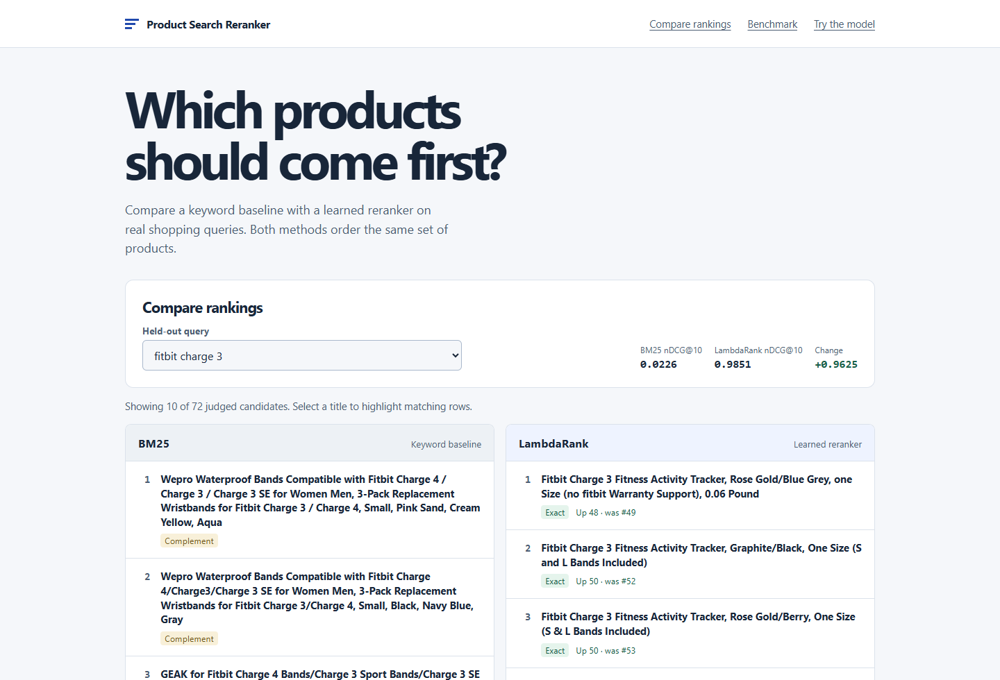

# Product Search Reranker

A shopping query can match a requested product, a compatible substitute, or an accessory. They may use the same words. This project tests whether a small learning-to-rank model can put the requested product higher than a keyword baseline.

It trains a CPU LightGBM LambdaRank model on [Amazon ESCI](https://github.com/amazon-science/esci-data), evaluates both rankers on the same held-out candidate lists, and serves the trained model through a web interface.



## Run the demo

Use Python 3.11+ from the repository root. Create a virtual environment and activate it before installing.

```sh
python -m venv .venv
# Windows PowerShell: .\.venv\Scripts\Activate.ps1
# macOS / Linux: source .venv/bin/activate
python -m pip install -e .
python -m product_reranker serve
```

Open [localhost:8000](http://127.0.0.1:8000). Compare the first ten results for selected held-out queries or enter a query and 2–40 product titles under **Try the model**. The demo loads the trained model and BM25 statistics from `models/` at startup. The [local API reference](http://127.0.0.1:8000/api/docs) also accepts descriptions, brands, colors, and bullet points.

The files in `docs/` can be published directly with GitHub Pages. This static version displays the benchmark replay. To host live inference, run the Python server with `--host 0.0.0.0` and the port provided by your host.

## Held-out results

| Query slice | Queries | BM25 nDCG@10 | LambdaRank nDCG@10 | Change |
| --- | ---: | ---: | ---: | ---: |
| All | 8,956 | 0.6834 | 0.7132 | +0.0298 |
| Short, 1–2 tokens | 1,712 | 0.6851 | 0.7207 | +0.0355 |
| Query matches a candidate title | 156 | 0.7863 | 0.8072 | +0.0209 |

The 95% interval for the overall change is **+0.0269 to +0.0328**. The reranker improved 4,790 queries, regressed on 3,397, and tied on 769. Five training query groups were removed because their normalized text appeared in test. Validation selected 71 boosting rounds.

The demo includes examples selected for visible changes. For *fitbit charge 3*, BM25 put replacement bands first and LambdaRank promoted the trackers. For *apple watch band with case*, LambdaRank pushed judged exact matches down and put complements first. Accessories are a recurring ambiguity when the query contains words shared by a product and its add-ons.

See the [benchmark report](docs/benchmark.json) for split counts, sample rankings, and runtime versions.

## Reproduce the training run

```sh
python -m product_reranker download
python -m product_reranker train
python -m product_reranker serve --model-dir artifacts
```

The downloader uses the two Parquet files from Amazon's pinned revision and verifies their SHA-256 checksums. Allow about 1.16 GB for source files. Training writes a native LightGBM booster, the BM25 feature statistics, and a JSON benchmark report to `artifacts/`. Add `--smoke-queries 100 --output-dir artifacts/smoke` to the training command for a smaller run. The smoke run still reads the original catalog. Copy a fresh `artifacts/benchmark.json` to `docs/benchmark.json` to replay that run on the site.

## Evaluation design

- **Candidates.** Filter to US English rows in Amazon ESCI Task 1. Keep the candidate lists for each official query ID intact and join product fields by ID and locale.
- **Split.** Hold out Amazon's official test split. Normalize queries with Unicode NFKC, case folding, and alphanumeric tokenization. Remove official training query IDs whose normalized text occurs in the test set, then reserve validation queries using a stable hash of normalized text.
- **Baseline.** Score `2 × BM25(title) + BM25(description)` with separate field lengths and inverse document frequencies estimated on unique training products. Break score ties by product ID.
- **Reranker.** Train LambdaRank on the two BM25 components and features for coverage, word order, phrase match, numeric tokens, brand, and color. The first eight title tokens, excluding brand and color words, provide a proxy for product type because ESCI has no category column. Select the number of boosting rounds on validation nDCG@10.
- **Outcome.** Average nDCG@10 across test queries. The gain scale is 100 for an exact product, 10 for a substitute, 1 for a complement, and 0 for an irrelevant result. A list with zero ideal gain receives a score of zero. The paired 95% bootstrap interval resamples normalized query clusters.

The benchmark evaluates reranking inside Amazon's existing candidate pools. Product IDs can occur in multiple splits, which reflects reranking against a shared catalog. In live mode the caller supplies the candidate pool. The learned features depend primarily on shared words or numbers, so the model can struggle with unfamiliar aliases and synonyms. The browser form only sends titles, while the benchmark uses the available catalog metadata.

## Development

```sh
python -m pip install -e ".[dev]"
python -m pytest -q
python -m ruff check .
python -m build
```

The [implementation plan](docs/implementation-plan.md) records the project scope. The [Shopping Queries Dataset paper](https://arxiv.org/abs/2206.06588) describes the collection and judgments. The bundled sample product titles and labels are derived from Amazon ESCI under its [license](docs/amazon-esci-license.txt) and [notice](docs/amazon-esci-notice.txt).
