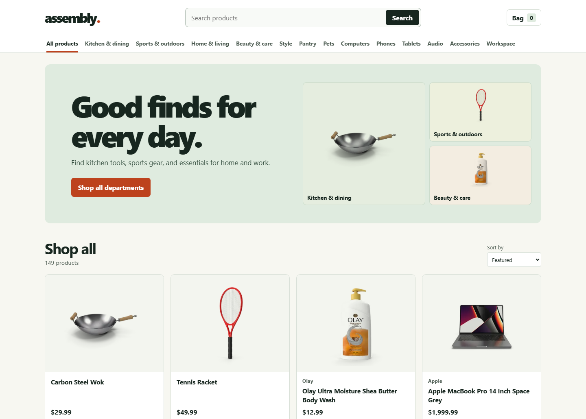

# Product Search Reranker · Assembly

Assembly is a storefront demo with **149 products across 13 departments**. It shows how hybrid search, supervised reranking, and product recommendations work together.



[Homepage after a search](docs/storefront-v3-context.png) · [Product recommendations](docs/storefront-product.png) · [Mobile view](docs/storefront-v3-mobile.png)

## What the models do

- **Find candidates.** Qdrant combines BM25 keyword matches with Granite embeddings, which represent the meaning of the product text.
- **Reorder matches.** LightGBM LambdaRank, trained on Amazon ESCI, reorders eligible products. The homepage preserves strong evidence for explicit attributes such as color.
- **Suggest products.** The homepage uses the latest search or last-viewed product. Two trained pair models rank alternatives and compatible add-ons on product pages. **Clear activity** resets the homepage context.

## Run locally

Requires **Python 3.11+** in a virtual environment (`venv`). The first run downloads the encoder.

```bash
python -m pip install -e ".[store]"
python -m product_reranker serve-store
```

Open the [local storefront](http://127.0.0.1:8000/store/).

Search `tennis practice gear`, then click the **Assembly** logo to return home and see the contextual recommendations.

## Evaluation

The ESCI benchmark uses held-out search queries. The homepage figures come from a small, manually reviewed set on the demo catalog.

| Evaluation | Scope | Metric | Result | Artifact |
| --- | --- | --- | --- | --- |
| **Core ESCI reranker** | 8,956 Amazon ESCI queries (offline benchmark) | nDCG@10 | `0.6834` → `0.7132` | [Benchmark and reproduction](docs/search-benchmark.md) |
| **Homepage contextual** | 22 reviewed matching searches (demo catalog) | nDCG@4 | `0.9332` → `0.9439` | [Homepage audit](docs/storefront-v3-audit.json) |
| **Homepage abstention** | Reviewed unmatched/ambiguous queries (demo catalog) | Abstentions | `8/8` | [Homepage audit](docs/storefront-v3-audit.json) |

[Storefront design and evaluation](docs/storefront-v3.md)

## Data sources

The ranking models use [Amazon ESCI](https://github.com/amazon-science/esci-data). The demo catalog and photos come from [DummyJSON](https://dummyjson.com/docs/products). Prices and the shopping bag are for demonstration.
